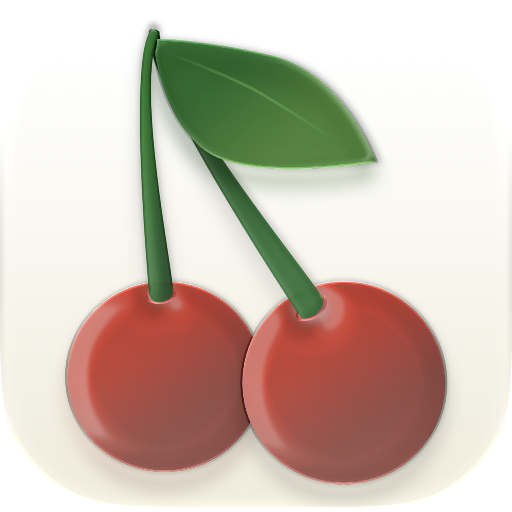
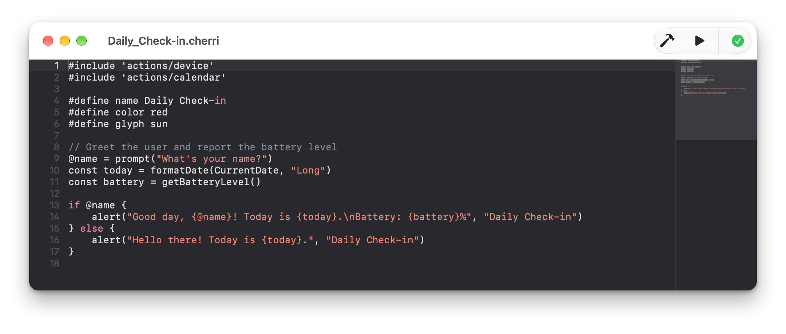
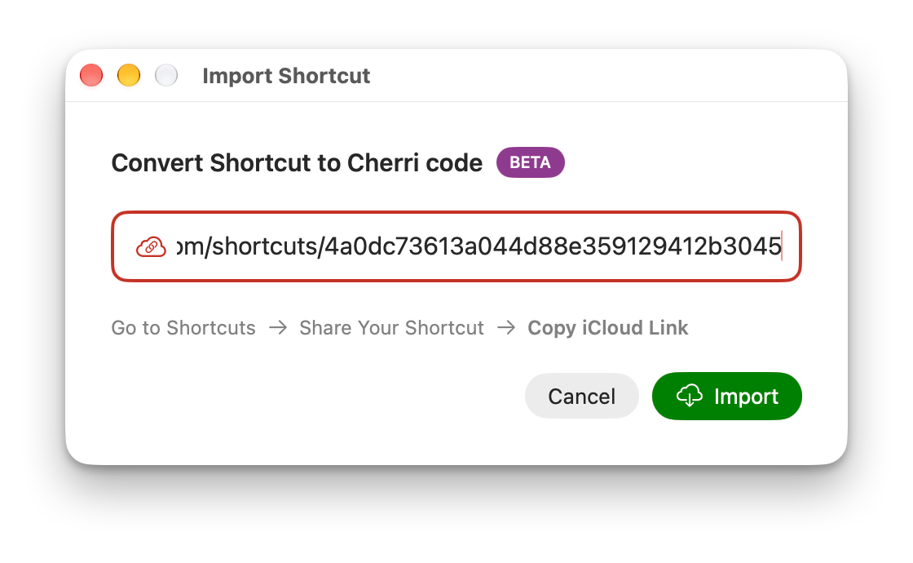
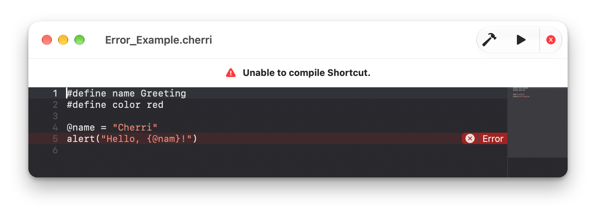
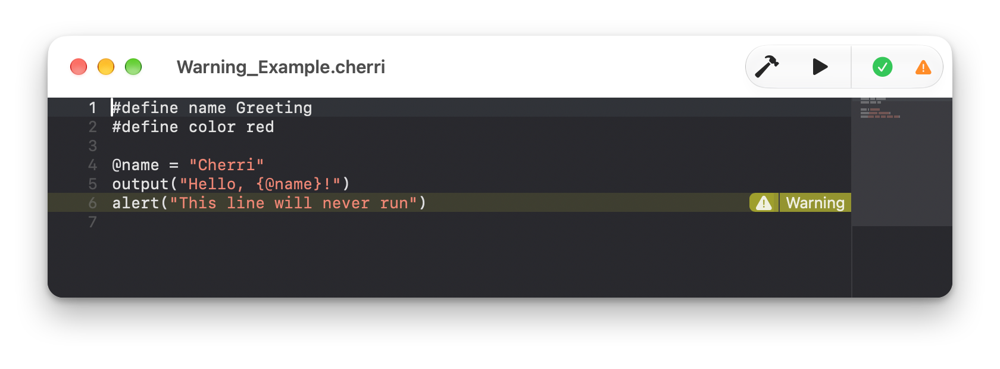
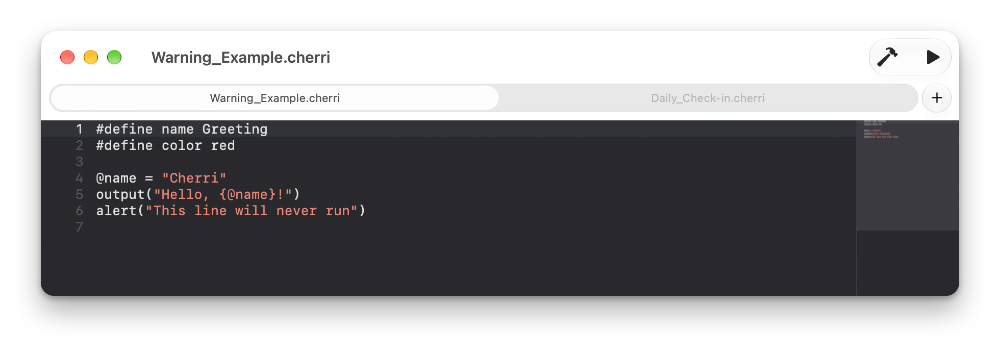
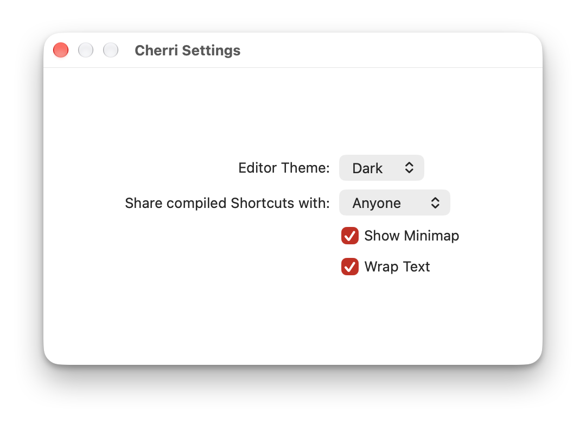

# Cherri IDE

IDE for the [Cherri programming language](https://github.com/electrikmilk/cherri).



## Features

### Document-based macOS app

Create, edit, save, open, duplicate, rename, etc. Cherri files.

### Build & Run
- 🔨 **Build:** Compile the current Cherri file into a Shortcut.
- ▶️ **Run:** Compile, then open the compiled Shortcut.

### Import from iCloud

Convert an existing Shortcut to Cherri code. Go to **File -> Import Shortcut...** (**⌘I**), paste the Shortcut's iCloud link and click **Import**. The Shortcut is converted and opened as a new Cherri document.

To get the link, go to Shortcuts -> Share Your Shortcut -> Copy iCloud Link.

This feature is in beta.



### Inline Errors & Warnings




### Tabs

Enable the tab bar in the Menubar in **View -> Show Tab Bar**. Click the plus button to create a new Cherri file.

If you open a file and it does not open in a new tab, go to your **System Settings** -> **Desktop & Dock** -> Set **Prefer tabs when opening documents** to _Always_.



### Document Type

This app sets up `.cherri` files as a type of plain text document.


If you have previews on, it shows the contents of the file.


### Settings



## Dependencies

- [CodeEditorView](https://github.com/mchakravarty/CodeEditorView)

## How to run

```bash
git clone --recursive https://github.com/electrikmilk/cherri-macos-app.git Cherri
```

### Requirements

- XCode - Download from the Mac App Store.
- Go - Install from Homebrew or [go.dev](https://go.dev/dl/).

### Run

1. Open `Cherri/Cherri.xcodeproj` in XCode.
2. Click the play icon button to build the project after it has been indexed.

This should "install" the project on your Mac, at least temporarily. But if it disappears due to being an unsigned app, just follow the steps above to re-install.
